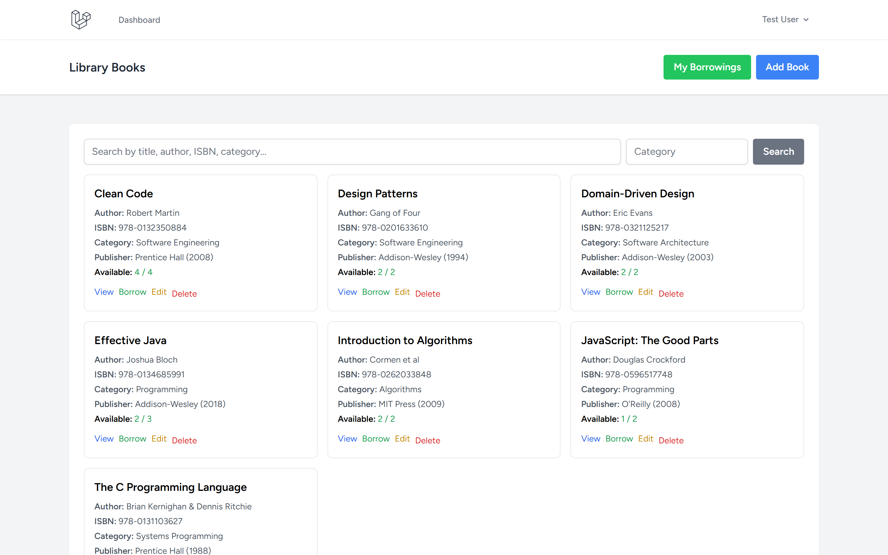
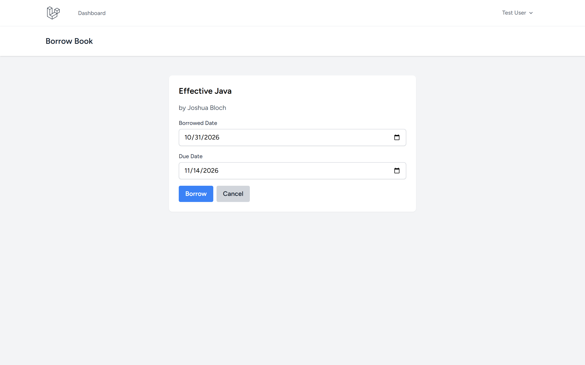
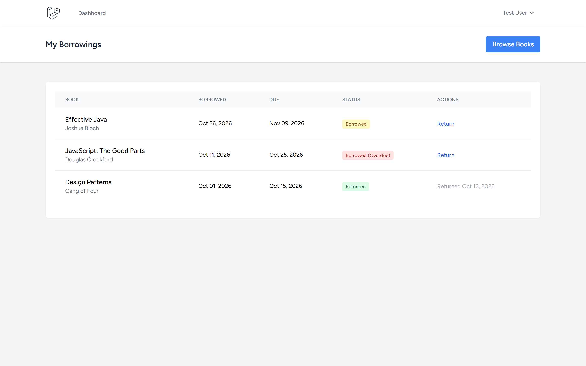
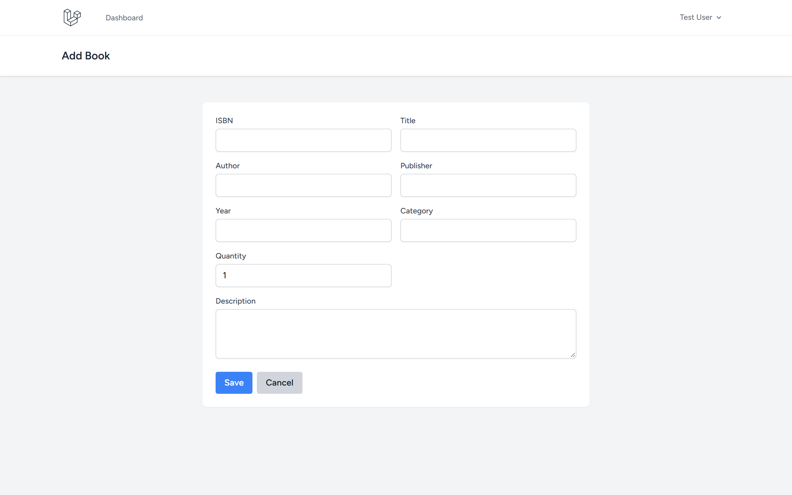

# Library Management System

A Laravel-based library management system with book catalog, borrowing system, and availability tracking.

Repository: https://github.com/0xyz-exe/library-management-app-laravel

## Screenshots

| Tampilan | Preview |
|---|---|
| **Katalog Buku & Pelacakan Ketersediaan Stok**<br>Tampilan utama koleksi buku perpustakaan dengan kartu informasi judul, ISBN, penerbit, kategori, status ketersediaan stok buku, dan filter pencarian |  |
| **Formulir Peminjaman Buku Perpustakaan**<br>Formulir transaksi peminjaman buku dengan ringkasan metadata buku terpilih, tanggal peminjaman, dan penentuan batas waktu pengembalian (due date 14 hari) |  |
| **Riwayat Peminjaman & Manajemen Pengembalian**<br>Tabel riwayat peminjaman buku aktif dengan indikator badge status (Borrowed, Overdue, Returned) dan tombol aksi cepat pengembalian buku |  |
| **Formulir Registrasi Buku Baru ke Katalog**<br>Formulir penambahan koleksi buku baru dengan input nomor unik ISBN, nama penulis, penerbit, tahun publikasi, klasifikasi kategori, dan total stok fisik |  |

## Features

- ✅ User authentication (Laravel Breeze)
- ✅ Book catalog with search
- ✅ Borrowing system
- ✅ Availability tracking
- ✅ Return management
- ✅ Overdue detection
- ✅ Borrowing history

## Tech Stack

- Laravel 13.38.0
- Laravel Breeze 2.4
- SQLite
- Tailwind CSS

## Installation

```bash
git clone https://github.com/0xyz-exe/library-management-app-laravel.git
cd library-management-app-laravel
composer install
npm install && npm run build
cp .env.example .env
php artisan key:generate
touch database/database.sqlite
php artisan migrate --seed
php artisan serve
```

Visit `http://localhost:8000`

## Demo Account

- Email: `test@example.com`
- Password: `password`

## Database Schema

**books**: id, isbn, title, author, publisher, publication_year, category, quantity, available, description, timestamps

**borrowings**: id, user_id, book_id, borrowed_date, due_date, returned_date, status (borrowed/returned/overdue), timestamps

## Usage

1. **Browse Books** - Search by title, author, ISBN, or category
2. **Borrow Book** - Select book and set due date (14 days default)
3. **My Borrowings** - View active and returned books
4. **Return Book** - Mark book as returned, updates availability
5. **Manage Books** - Add, edit, delete books (admin)

## Features Detail

### Book Management
- Add/edit/delete books
- ISBN validation
- Quantity tracking
- Availability status

### Borrowing System
- Borrow available books
- Set due dates
- Track borrowing history
- Return functionality
- Overdue detection

### Search & Filter
- Search by title, author, ISBN, category
- Category filtering
- Availability status

## Security

- User authentication required
- User can only return own borrowings
- Cannot delete books with active borrowings
- CSRF protection
- Input validation

## License

MIT
